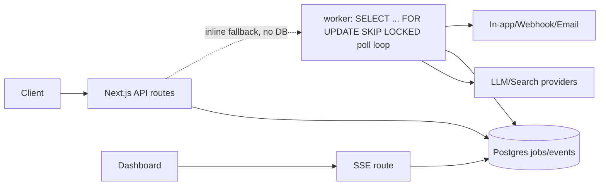

# Architecture

Relay is split into three replaceable layers.

The worker (`workflows/dev-worker.ts`, run via `npm run worker`) is a real, independent
process when `DATABASE_URL` points at a reachable Postgres instance: it polls
`claimNextJob()`, which atomically claims one `queued`/`retrying` job via
`SELECT ... FOR UPDATE SKIP LOCKED` so multiple worker replicas can run safely without double-
processing the same job. Without a reachable database, there is no shared store a separate
process could read from, so the API process executes jobs inline instead (`lib/jobs/service.ts`
checks `isUsingPostgres()` to decide which mode it's in).

## State Machine

`queued -> processing -> retrying -> complete`

Terminal alternatives are `failed` and `cancelled`. Workers check cancellation between steps and write status transitions to `job_events`.

## Realtime

Backed by Redis pub/sub when `REDIS_URL` is set and reachable — a startup health check picks
the backend once and falls back to a local in-process event bus otherwise (same pattern as
the database layer). See `lib/realtime/bus.ts`.

## Delivery

Completion calls the delivery layer. In-app delivery marks the result unread, webhook delivery signs the JSON payload with HMAC-SHA256, and email delivery is gated by provider configuration.
